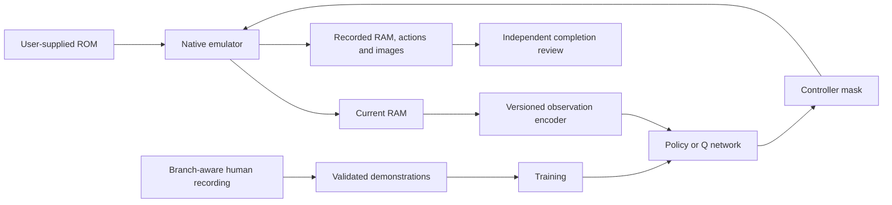

# Architecture

## Runtime

The selected workflows use `RecorderNative` to step the NES emulator with raw controller masks and read its 2,048-byte CPU RAM. Full-state snapshots carry ROM, build, and payload identities. Loading a state validates these identities before replacing the native owner.

Human recordings follow checkpoint ancestry across rewinds. Only transitions on the selected ancestry are used; a rewind is not treated as a causal gameplay step.

## Implementation map

| Component | Main implementation |
| --- | --- |
| CLI and paths | `run.py:main`, `paths.py:ROOT` |
| Native ownership and state loading | `recorder_native.py:RecorderNative`, `kind18_observer.py:Kind18ObserverNative` |
| General Gymnasium wrapper | `rl_env.py:PrinceValiantRamEnv` |
| RAM semantics and geometry | `game_state.py`, `scene_state.py`, `navigation.py:NavigationEncoder` |
| Level 1 environment and curriculum | `backward_level1.py:HumanRoute, Level1Env, BackwardCurriculum` |
| Temporal models and history | `training/temporal_models.py`, `training/temporal.py:FrameHistory`, `control_history.py` |
| DQN / DQfD | `training/dqn.py:DuelingQ`, `training/dqfd.py`, `training/dqfd_execution.py` |
| Replay and checkpoint validation | `training/dqfd_transitions.py:TransitionCache`, `training/dqfd_replay.py`, `training/dqfd_pretraining.py:load_committed_milestone` |
| PPO training and workers | `scripts/train_backward_level1.py`, `training/process_envs.py` |
| Level 2 actor and completion check | `training/level2_demonstration_policy.py:DemonstrationActor`, `training/level2_completion_evidence.py:CompletionEvidence` |
| Level 3 actor and ending evidence | `training/level3_imitation.py:Level3ImitationActor`, `training/level3_evidence.py` |

Unqualified modules above are under `src/prince_valiant_rl/`. The [symbol index](../manifests/source_symbols.json) lists exact exported files and their top-level functions/classes. The [dependency graph](../manifests/dependency_graph.json) records transitive imports and dynamic entry points.

## Learning contracts

**Level 1.** The selected checkpoint uses the dueling temporal DQN architecture with 17 actions and 1,234,458 parameters. Its metadata defines feature shapes, categorical/terrain embeddings, CNN/GRU branches, and history offsets `[-60, -30, -15, -9, -6, -3, 0]`. DQfD combines duration-aware one- and ten-step Double-Q targets, demonstration margin supervision, prioritized replay, and the implemented regularizer. The selected continuation is demonstration-only; it performs no online collection. Exact configuration and state hashes are retained in the [selection record](../analysis/level1_dqfd_demo_continuation_20261025/selected_checkpoint.json).

The PPO implementation retains separate policy/value processing, rollout workers, backward suffix curricula, and config-dependent observation/reward variants. Its historical results are not a controlled algorithm comparison with the later DQfD study.

**Level 2.** The selected title-inclusive actor has 559,504 parameters and maps current raw RAM to 16 observed controller masks. Normalization is stored in the checkpoint. Training uses the complete selected human route and a v56 parent actor. The evaluation tail uses ordinary confirm-button inputs after the candidate completion flag; it does not demonstrate learned Level 3 play.

**Level 3.** An independently initialized MLP maps 2,048 current RAM bytes through 512- and 256-unit hidden layers to 22 mask logits, with 1,186,070 parameters. Per-byte normalization follows division by 255, with a 0.02 standard-deviation floor. These are opaque RAM inputs, not verified Level 2 semantics. Inference uses no demonstration lookup, external frame index, or playback cursor.

## Native source

The repository retains only native include/source files, recorder and observer wrappers, build scripts, and notices. Generated trees and DLLs are excluded. See [setup](SETUP.md) for compiler requirements and the historical-state compatibility constraint.
