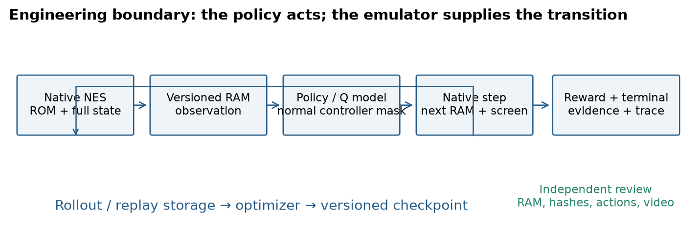
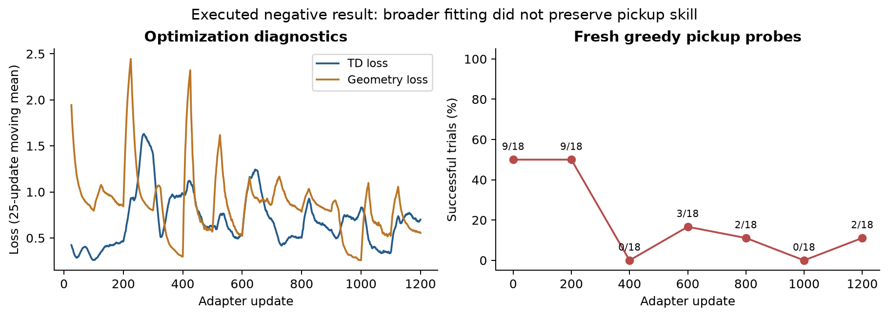
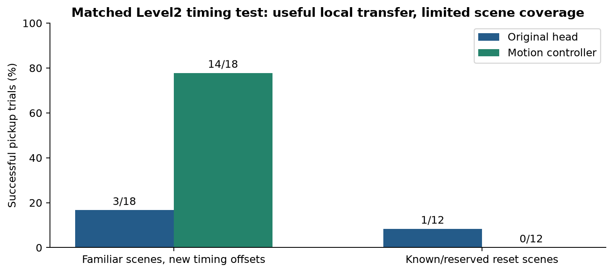
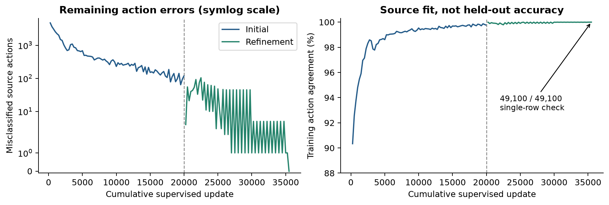
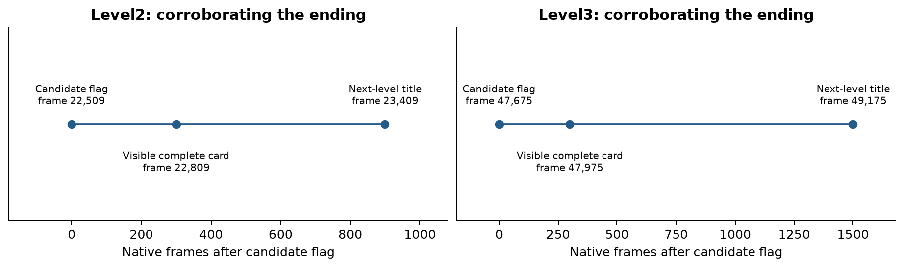
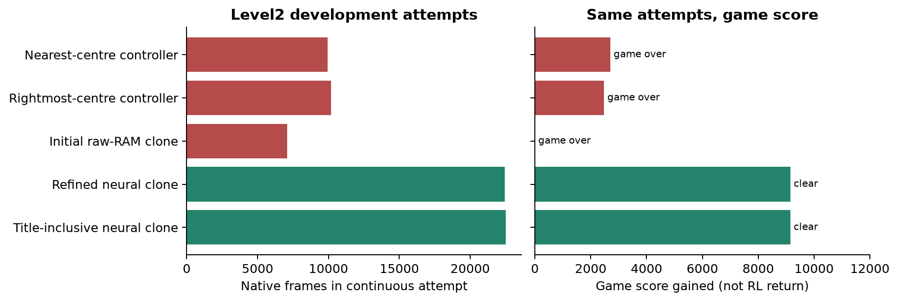

# Prince Valiant: engineering a reproducible learning environment

> Interview case-study draft. Measured results and hypothetical proposals are separated.

## Engineering a reproducible NES learning environment

Orkun Taha Öznergiz | RL developer interview case study | 26 October 2026
DRAFT — measured results, explicit limitations, and reproducibility notes

The project turns The Legend of Prince Valiant into an instrumented learning problem: a native emulator bridge, verified numeric observations, rewind-aware human demonstrations, temporal neural policies, reinforcement-learning experiments, and independent completion review. My central engineering contribution was making the environment and its evidence trustworthy enough to diagnose learning failures.

The work combines PPO and demonstration-assisted value learning with pragmatic supervised policies. Level 2 exposed a difficult interaction between combat, shooting dropped E/T bonuses, survival and timeout. Local pickup improvements did not reliably transfer to a continuous run. A refined raw-RAM imitation policy eventually completed the level. For Level 3, the accepted scope was a simpler neural clone of the successful human route; the final model reached the visible completion card and the next level title.

The strongest demonstrated result is a continuous Level 3 model-driven run with all 49,775 decisions independently recomputed from current RAM and the checkpoint. Level 2 completion is corroborated by the completion card and subsequent Level 3 transition. These are known-route demonstrations, not evidence of broad generalization.

The task brief permits imitation, separate level models and training save states. It also requires at least 7 successes in 10 evaluation episodes and a normal-game start for Level 1 evaluation. This report does not establish those requirements. A complete submission still needs that campaign, a selected Level 1 normal-start audit, and the requested presentation video. Historical fixed-reset Level 1 results must not be substituted for that audit.

Reading guide: pages 2–5 cover environment, representation, algorithms and rewards; pages 6–8 show measured experiments; page 9 audits completion; page 10 covers limitations and explicitly hypothetical Level 3 experiments.

## 1. Build the environment before optimizing the agent

The Python interface wraps a native NES recorder/emulator DLL through ctypes. Each action advances native emulation, returns the actual 2,048-byte RAM state, and retains rendered frames and event evidence. Frame skip is one. Simulation-time conversions use a 60-native-frame convention; they are not wall-clock performance measurements.

Human play is recorded in SQLite with native full-state snapshots and rewind ancestry. A rewind creates a branch, not a valid causal transition to the next recorded row. Dataset extraction follows the selected ancestry and checks pre/post RAM continuity. Source row identifiers are provenance only; they are excluded from policy input. Full-state envelopes carry ROM/build/payload hashes; a fresh native owner on load avoids contaminated emulator state.

Reverse engineering separates observed bytes from verified semantics. Instruction traces, ROM context and bus writes support interpretations of entities and game events. Undocumented bytes remain opaque. Loaded framebuffers can be stale, so terminal reference images are established through active rendering rather than trusting a snapshot screenshot.

The environment supports training resets and controlled diagnostic interventions, while completion evaluation runs continuously without RAM edits, mid-run resets or action playback. This separation prevents a useful laboratory probe from becoming a misleading success claim. Resource gates check memory, commit headroom, GPU and disk before expensive work; a rejected launch is not a gameplay failure.

Engineering invariants: exact RAM parity, branch-safe transitions, versioned schemas, preserved failed artifacts, and independent review of the actions actually taken. The diagram is an architecture illustration, not a measurement.

## 2. Observation and model contracts

The structured Level 1 representation combines categorical embeddings, masked entity/projectile/trigger records, terrain convolutions and normalized continuous features. A WindowPath encoder fuses these features and feeds a GRU over seven sampled history frames: −60, −30, −15, −9, −6, −3 and 0. The GRU resets for each window; it is not a persistent episode-wide hidden state. Masks distinguish missing history, unavailable terrain and inactive objects. Motion must not cross deaths, resets or slot reuse.

Representative Level 1 PPO checkpoint: separate actor and critic window encoders, with 1,234,329 actor parameters and 1,232,265 critic parameters (2,466,594 combined). A separate dueling DQfD checkpoint has 1,234,458 online-network parameters. These are documented research artifacts, not a declaration of which checkpoint satisfies the final normal-start evaluation requirement.

The final Level 2 imitation model uses current raw RAM: 2,048 → 256 → 128 → 16, totaling 559,504 trainable parameters. Its exact controller-mask vocabulary was recovered from the recording rather than forcing unsupported human actions into an older action set. The title-inclusive dataset contains 22,509 rows, including 60 title frames.

Level 3 deliberately uses a separate raw-RAM schema: 2,048 → 512 → 256 → 22, totaling 1,186,070 parameters. Byte values are scaled and normalized using saved training mean/std buffers, with a standard-deviation floor of 0.02 in the implementation. The model stores 4,096 normalization values in addition to trainable parameters. Its input contains no source frame number, recording ID, future observation or playback cursor.

The three final/research families therefore do not share one architecture or model size. Structured temporal policies encode reusable game structure; raw-RAM MLPs trade interpretability and robustness for a compact route-specific solution. Current RAM can encode game timing and route state, so removing an explicit frame counter does not establish generalization.

Reproduction needs more than a model file: compatible code, schema/action vocabulary, normalization, ROM/native build, initial state and numeric execution settings. A checkpoint alone does not specify the environment. Strict FP32 inference and single-row runtime checks matter because a tiny logit change can alter a long deterministic trajectory.

## 3. Reinforcement learning: policy and value learning

PPO learns a categorical actor with a separate critic. Collection samples actions; deterministic review chooses the greedy action. The clipped surrogate limits the incentive for large policy changes: maximize E[min(ratio × advantage, clip(ratio, 1−epsilon, 1+epsilon) × advantage)]. Generalized advantage estimation combines temporal-difference residuals with gamma and lambda; the critic regresses return targets. Entropy regularization controls exploration pressure.

A representative Level 1 recovery configuration uses actor learning rate 1e−5, critic rate 3e−4, clip 0.1, gamma 0.99997, GAE lambda 0.9995, 3 PPO epochs, 6 environments, 2,048 rollout steps per environment and minibatches of 512. Its entropy coefficient is a constant 0.0002. The infrastructure supports schedules, but this configuration does not demonstrate entropy decay. The long horizon reflects delayed progress/completion rewards and the cost of early mistakes.

The value-learning branch uses a dueling network: Q(s,a)=V(s)+A(s,a)−mean(A(s,*)), with the same temporal observation family. Double-Q targets select the next action using the online network and evaluate it with the target network. Action masks remove unavailable choices. Importance-weighted Huber losses and gradient clipping stabilize replay updates.

Demonstration-assisted DQfD combines one-step TD loss, ten-step TD loss, a demonstration large-margin term, and L2 regularization. The margin is 0.8, prioritized replay exponent 0.4, priority epsilon 0.001 and demonstration bonus 1.0; the helper's default L2 coefficient is 1e−5. Episode boundaries and deaths must stop n-step accumulation. Target-update cadence is experiment-specific, not a universal setting.

Forward/backward curricula expose hard sections through training resets. Demonstration rehearsal anchors behavior, while online rollouts test whether local gains survive policy-induced state shifts. Reset prehistory reconstructs observation and reward bookkeeping: an agent must not receive progress or objective bonuses again merely because it starts beyond them.

The engineering lesson is that a lower optimizer loss and a successful local reset are intermediate diagnostics. The decision criterion is retained behavior and continuous gameplay. Pages 6–7 show why that distinction changed the final approach.

## 4. Reward design and anti-hacking controls

Rewards are versioned per experiment. The following values describe a representative Level 1 PPO recovery configuration; they are not a claim that every historical run used one reward function. Each coefficient multiplies its implementation-defined event or feature delta.

Level 1 coefficients: level_completed +40; checkpoint_reached +2; objective_cleared +3; new_progress +0.2; route_corridor +2; combat_potential +6; enemy_kills +0.25; score_gain +0.00005; player_damage −2; death_started −2; lives_lost −4; game_over −4; elapsed_seconds −0.03; enemy_damage 0; abi2_kind18_defeat 0. These are all 15 configured terms. Coefficient magnitude alone does not determine contribution: feature scale and event frequency matter.

The Level 2 baseline v4 uses completion +100, game-over −25, energy-loss fraction −5, elapsed seconds −0.01 and score gain ×0.01. Kill, progress and shot terms are zero. Later v9 adds aim potential ×0.25 and aim-hold +0.03 per second. A current reward-config pointer is historical training configuration; the final supervised completion model does not optimize this reward.

Shaping provides feedback before sparse completion, but can reward standing in a favorable aiming state, repeating progress payouts after resets, or pursuing score while running out of time. Defensive measures include delta-based bookkeeping, reset-aware baselines, completion/death checks, frozen old-task probes and full-run gates. A candidate flag is a hypothesis until corroborated by rendered game evidence and the next-level transition.

Dropped E and T letters are actionable objectives: the agent must shoot them rather than merely move nearby. State timing, aim and projectile interactions make successful local action sequences brittle. The final Level 2 audit records 10 collections out of 20 drops: 7 E and 3 T, with 10 missed. The observed raw energy gain totals 896. This supports the conclusion that enough bonuses were collected to finish this run; it does not support a perfect pickup policy or an inferred conversion of raw timer bytes into seconds.

Supervised imitation uses action-label loss rather than environment reward. Its evaluation therefore reports game score, episode length, visible completion and action provenance separately from RL return. Those quantities must not be merged into one misleading learning curve.

## 5. Measured failure: optimization versus behavior

The expanded Level 2 drop adapter study (v33) is an executed failure, not a reconstructed story. A frozen approximately 1.234-million-parameter backbone received a 2,312-parameter residual head. Across 1,200 sequential updates, the source pickup probe declined from 9/18 to 2/18. Intermediate checkpoints reached 0/18 at updates 400 and 1,000. None of six full-run gates passed, even though nine old-enemy probes retained their exact behavior.

The figure juxtaposes optimization diagnostics with behavioral probes. The loss traces are 25-update means; pickup points use the saved 18-case probe set. They are repeated tests on correlated scenarios, not independent binomial trials. A decreasing objective cannot establish policy improvement when the measured objective behavior deteriorates.

Subsequent work explicitly controlled retention: balanced replay and successful-agent rehearsal in v35 were stopped after 25 steps because of forgetting, restoring step zero. In v37, a 442-row action-retention gate accepted one update and rejected the next. These results motivated bounded updates and preserved rollback points instead of trusting a long unconstrained fine-tune.

Memory-assisted variants improved source probes through 10/18, 14/18 and 15/18, but new timing offsets remained only 3/18 in the relevant baseline/memory comparison. Added memory capacity is a changed method, so this is not a clean neural-architecture comparison. The useful finding is narrower: source coverage can rise without solving timing sensitivity.

The practical capability demonstrated here is experimental diagnosis: keep the old controller fixed, isolate the new objective, measure retention, and reject changes that improve a proxy while failing the intended behavior. Failed runs remain part of the evidence trail.

## 6. Transfer limits and the Level 2 pivot

A separate motion-feature model (v51) added 11,473 parameters, producing a total of 1,248,243. It used 26 causal motion/dispatch features and 2,000 training updates. Source cases reached 18/18. On matched new timing offsets of familiar scenes, pickup success increased from 3/18 to 14/18. On reserved scenes, baseline 1/12 became 0/12. Nine original enemy probes remained exact. The figure shows both gains and the failure to transfer.

These are finite, correlated reset cases. They do not justify a population success rate, a significance claim or robust unseen-scene competence. In continuous v53 tests, a fixed programmed upstream controller yielded six drops in each 12-trial arm; this does not establish improved neural combat or solve the whole route.

The final decision was to use a neural human-imitation policy for completion. Programmed nearest-centre and rightmost-centre full attempts failed after 9,942 and 10,171 frames, with score gains 2,700 and 2,475. An initial raw-RAM clone fit 22,338/22,449 gameplay rows but failed live after 7,096 frames with score gain zero. High label accuracy was insufficient for a long closed-loop trajectory.

Hard-example refinement added 7,400 low-rate updates, achieved exact source agreement and completed the 22,449-frame gameplay route with score gain 9,150. A title-inclusive model trained for 8,000 updates completed 22,509 frames with the same score gain despite one source mismatch. These attempts differ in initialization and route coverage, so the accompanying development chart is descriptive, not a controlled algorithm comparison.

Four later bonus-priority variants collected zero bonuses and failed. The baseline completion model was retained. This is a deliberate scope decision: preserve the demonstrated solution while recording the unresolved bonus-control weakness.

## 7. Level 3: a supervised route-completion model

The Level 3 objective was explicitly narrowed to a human-imitation model that completes the level. The selected rewind ancestry supplies 49,100 current-RAM/action pairs over source frames 44,700–93,800, including the intro and transition tail. There are 49,100 unique RAM rows and no conflicting labels. All rows are training data; no held-out accuracy is claimed. The vocabulary contains 22 exact raw controller masks.

The initial 20,000-update fit reached 49,036/49,100 source agreement. It was an incomplete supervised fit, not a failed live Level 3 RL experiment. A 15,500-update low-rate hard-example continuation achieved 49,100/49,100 agreement in the exact single-row inference path. The figure plots recorded checkpoints against cumulative optimizer updates. Zero training errors are a route-reproduction milestone, not proof of robustness to new starts.

Recorded fit wall times are 38.92 and 47.25 seconds: 86.18 seconds total for these two GPU fitting stages. This excludes demonstration recording, preparation, native validation, evaluation, earlier research and human engineering time. No full-project training-hour total is available. Recorded environment: Python 3.13.1, PyTorch 2.14.1+cu130, CUDA 13.0, NVIDIA RTX 4060 Laptop GPU with approximately 8 GiB VRAM. CPU identification in the audit is Intel64 Family 6 Model 186 Stepping 2; no unverified commercial model is asserted.

Observation validation checked 360 native transitions at three anchors and 244 further reference steps, with exact RAM parity. Another 908 actively rendered reference frames established the terminal cards. The continuous evaluation then recorded 49,775 model actions. Every action was independently recomputed from current RAM and the final checkpoint; no demonstration lookup or optimizer ran during inference.

The first 49,100 source-range states matched the reference exactly. The 675-frame tail extends beyond that extraction, but is transition evidence rather than a meaningful generalization test. Five focused observation/model/evidence tests passed. The approach succeeds at the accepted narrow objective while leaving distribution-shift robustness unmeasured.

## 8. Completion evidence and reproducibility boundaries

Level 2: the extended v59 run showed the visible LEVEL 2 COMPLETE card at native frame 22,809, the Level 3 title at 23,409, and Level 3 gameplay at 23,709. The earlier F3 byte alone was insufficient because it could retain a previous-stage value. Review requires a fresh state transition and rendered corroboration. The selected policy collected 7 E and 3 T bonuses; it did not collect every drop.

Level 3: candidate completion flag at frame 47,675, visible LEVEL 3 COMPLETE at 47,975, and the Level 4 Sea Battle title at 49,175. Recording continued through 49,775. At the stated 60-frame convention, the recording spans 829.58 simulated seconds. The source video samples every other native frame at 30 fps; this is not a wall-clock inference benchmark or the final edited interview video.

The title reviewer originally rejected a fixed-position image comparison. Investigation found a two-pixel native narrative scroll. The revised check uses exact RGB comparison over a bounded ±4-pixel vertical shift, rather than a loose similarity threshold. The initial rejection is preserved. This illustrates why reviewers need validated invariances as well as strict checks.

Final Level 3 checkpoint: training/level3_imitation_refine_v2_20261026/best.pt. SHA256: 1481dd27a35a04e97bcb9dd25717171d16d25fa9063e18cda69e404f9f5afbcb. Reset state: analysis/level3_imitation_v1_20261026_preparation/frame_44700.state. Level 2 policy: training/level2_title_bc_v57_20261026/actor.pt. Reproduction contracts are in docs/LEVEL3_IMITATION.md and docs/LEVEL2_VALIDATION.md.

Audit scope: continuous model-driven Level 2 and Level 3 completion is supported on the documented route/reset conditions. A ten-episode campaign, cross-start reliability, one continuous three-level campaign, and Level 1 normal-start compliance are not established by these artifacts. One known-route success must not be presented as a 100% benchmark rate. Game score and imitation accuracy are not environment-return or completion-rate estimates.

## 9. Interview discussion and next validation steps

The project demonstrates native/Python integration, reverse engineering with provenance, temporal observation engineering, PPO and demonstration-assisted Q-learning, replay integrity, constrained experimentation, and independent evaluation tooling. The most consequential decision was to prioritize trustworthy evidence over optimistic proxy metrics. The final Levels 2 and 3 solutions are supervised neural policies, so describing the entire outcome as an RL-only success would misrepresent the work.

Before submission: select and audit the Level 1 checkpoint from normal game start; freeze code, schemas and reset conditions; run the required ten-episode evaluation protocol and report every outcome; explicitly state how deterministic repeated starts are interpreted. Add varied starts or perturbations as a separate robustness study rather than silently changing the official protocol. Record total compute/wall time prospectively. Produce the required 3–5-minute, at-least-720p presentation video with uncropped aspect ratio and uncut within-level final footage. The present long evaluation videos are source evidence, not that finished deliverable.

Hypothetical Level 3 experiments — NOT EXECUTED RESULTS
The following proposals answer the request for possible failed-experiment narratives without inventing history. They must remain labeled hypotheses, be removed from a final results section, or be replaced by actual logged experiments.

H1: PPO from scratch with sparse completion reward. Hypothesis: long-horizon exploration yields few completion signals. Test with a declared compute budget, multiple seeds, terminal reach counts and return curves; compare shaped and unshaped variants. No Level 3 PPO run or measured failure is claimed here.

H2: transfer the structured Level 1/2 feature schema to Level 3. Hypothesis: reused semantic assumptions omit level-specific dynamics. First validate native semantic parity and masks, then compare matched-budget policies. No transferred Level 3 RL result is claimed.

H3: behavior cloning followed by online fine-tuning. Hypothesis: online updates forget critical rare actions or leave demonstration coverage. Measure old-route action retention, new-state recovery and continuous completion, with rollback gates. The actual Level 3 work establishes supervised refinement only; its initial fit/refinement sequence is not evidence that this proposed RL fine-tune failed.

Source and figure audit: assets/source_manifest.json hashes figure inputs; assets/statistics.json and CSV exports expose the plotted counts. The executable figure builder and report builder preserve regeneration. No invented experiment is included in measured graphs. This is a reviewable draft, with remaining acceptance gaps visible rather than hidden.

## Additional development figure

Descriptive attempts with different conditions; not a controlled comparison.

